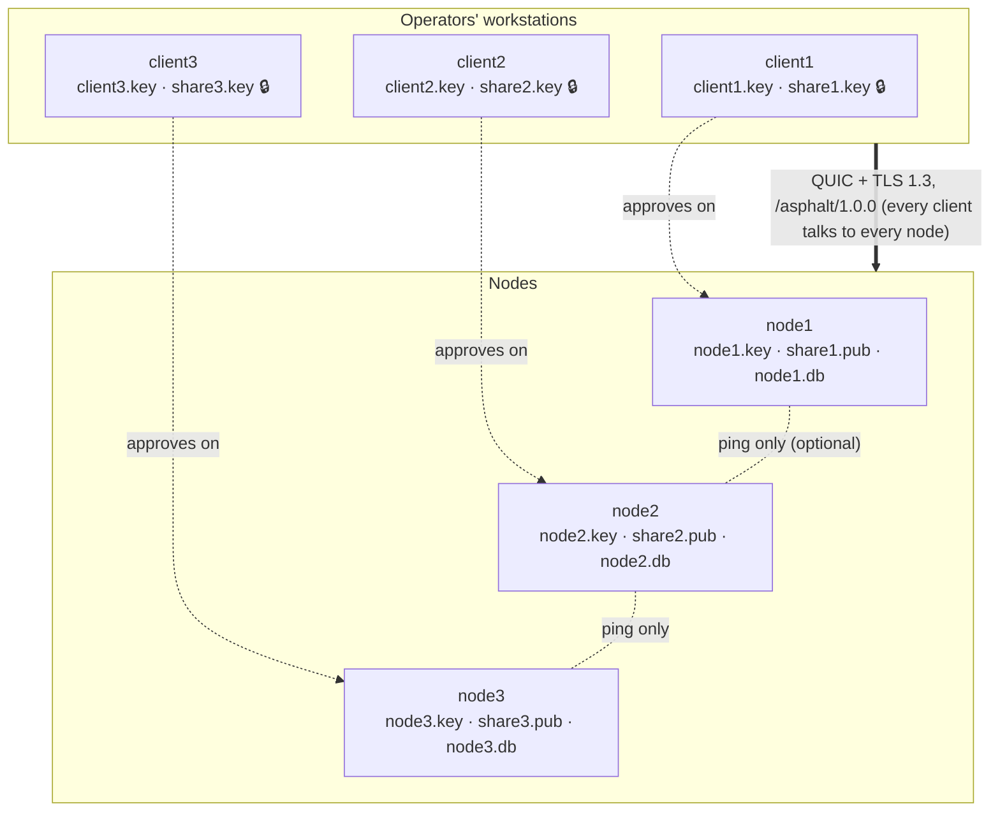
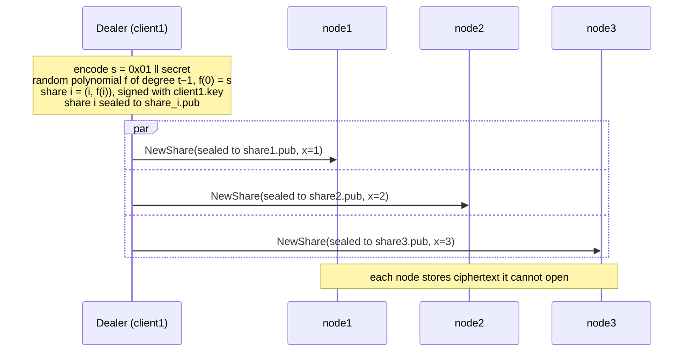
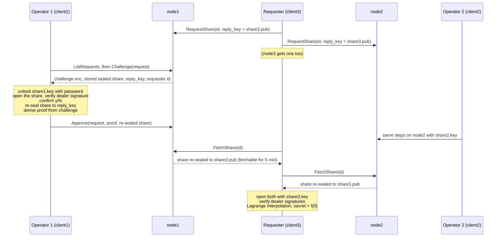

# asphalt

**Threshold secret storage on a small peer-to-peer network.**

asphalt splits a secret, such as a root password, a recovery key or an API token, into *n* shares
with Shamir's Secret Sharing and gives one share to each of *n* nodes. Any *t* shares restore the
secret, and *t − 1* shares reveal nothing about it.

Every share is end-to-end encrypted to the **operator** of the node that stores it, using HPKE
with the post-quantum hybrid KEM X-Wing (ML-KEM-768 + X25519). Nodes only ever hold ciphertext. A
share leaves its node only after that node's operator unlocks their password-protected key and
explicitly approves the request. To get a secret back you need *t* separate people to agree.

```text
                 push: split, sign, seal share i to operator i's key
  secret ──► client ──────────────┬──────────────────┬──────────────────┐
                                  ▼                  ▼                  ▼
                           node1 [x=1 🔒]     node2 [x=2 🔒]     node3 [x=3 🔒]
                                  │ op1 approves     │ op2 approves     │ (not needed)
                                  ▼                  ▼
  secret ◄── client ◄──── any 2 of 3 shares, re-sealed to the requester ────
                 restore: Lagrange interpolation at x = 0
```

---

## Contents

- [How it works](#how-it-works)
  - [Roles](#roles)
  - [Keys and files](#keys-and-files)
  - [Lifecycle of a secret](#lifecycle-of-a-secret)
- [Algorithms](#algorithms)
  - [Shamir's Secret Sharing over a 2048-bit prime field](#shamirs-secret-sharing-over-a-2048-bit-prime-field)
  - [Share encryption: HPKE with X-Wing](#share-encryption-hpke-with-x-wing)
  - [Dealer signatures: Ed25519](#dealer-signatures-ed25519)
  - [Approval proof: HPKE secret export](#approval-proof-hpke-secret-export)
  - [Password-protected key files: Argon2id + AES-256-GCM](#password-protected-key-files-argon2id--aes-256-gcm)
  - [Transport: libp2p over QUIC / TLS 1.3](#transport-libp2p-over-quic--tls-13)
  - [Node storage: SQLite and a durable inbox](#node-storage-sqlite-and-a-durable-inbox)
  - [Wire protocol](#wire-protocol)
- [Security model](#security-model)
- [Building](#building)
- [Tutorial: three nodes with a 2-of-3 threshold](#tutorial-three-nodes-with-a-2-of-3-threshold)
- [Storing a password](#storing-a-password)
- [Restoring a password](#restoring-a-password)
- [CLI reference](#cli-reference)
- [Running nodes as systemd services](#running-nodes-as-systemd-services)
- [Operations](#operations)
- [Limitations](#limitations)
- [Troubleshooting](#troubleshooting)
- [Project layout and tests](#project-layout-and-tests)

---

## How it works

### Roles

| Role | What it is |
|---|---|
| **Node** | A long-running server (`asphalt --node`). It stores sealed shares and share requests in SQLite and answers calls from allowlisted clients over libp2p. It **cannot read** any share. |
| **Operator** | The person responsible for a node. They hold the *share secret key* that matches the node's `share.pub`, encrypted with a password, on their own machine and never on the node. Each node has exactly one operator key. |
| **Client** | The `asphalt client` CLI that an operator runs. It reads a `client.toml` listing every node. |
| **Dealer** | The client that **pushes** a secret: it splits the secret, signs the shares and seals each one to a node's operator key. |
| **Requester** | The client that wants a secret back. It **requests** the shares, waits for approvals, then **restores** the secret. |
| **Approver** | An operator who **approves** a pending request *on their own node*: they unlock their key, check the share and the requester, and re-seal the share to the requester. |

One operator usually plays all client roles: they push secrets, request them, and approve on
their own node. A requester who wants their own node's share must also approve that request
themselves.

### Keys and files

| File | Created by | Algorithm | Secret? | Where it lives |
|---|---|---|---|---|
| `nodeN.key` | `asphalt keygen` | Ed25519 (libp2p protobuf encoding) | **yes** | Node N only |
| `clientN.key` | `asphalt keygen` | Ed25519 | **yes** | Operator N's workstation |
| `shareN.key` | `asphalt keygen --share` | X-Wing secret key, encrypted with Argon2id + AES-256-GCM | **yes** (password-protected) | Operator N's workstation only, **never on a node** |
| `shareN.pub` | `asphalt keygen --share` | X-Wing public key (1216 bytes, hex) | no | Node N, and every client's config |
| `nodeN.db` | the node, on first start | SQLite (WAL) | contains only ciphertext and metadata | Node N |
| `client.toml` | you | TOML | no | Each workstation |

Each Ed25519 identity key has a **peer id** (`12D3KooW…`): a hash of its public key. Nodes
allowlist clients by peer id, and client configs pin each node by peer id, so both sides of every
connection are authenticated. `keygen` writes key files with mode `0600` and refuses to overwrite
an existing file unless you pass `--force`.



### Lifecycle of a secret

**1. Push.** The dealer splits the secret and seals one share to each node:



**2. Request → approve → restore.** Here client3 wants the secret back, and operators 1 and 2
approve:



---

## Algorithms

### Shamir's Secret Sharing over a 2048-bit prime field

*Implemented in [`src/main.rs`](src/main.rs) (`evaluate_horner`, `lagrange`,
`threshold_restore`) and [`src/client.rs`](src/client.rs) (`push`, `restore`).*

All arithmetic is in the prime field GF(*p*), where *p* is the 2048-bit prime from
[RFC 5114 §2.3](https://www.rfc-editor.org/rfc/rfc5114#section-2.3). asphalt uses only the prime
as a modulus and does not use the Diffie-Hellman group structure.

**Encoding.** The secret is at most 254 bytes. A `0x01` byte is prepended, and the result is read
as a big-endian integer:

$$s = \mathrm{int}_{\mathrm{BE}}(\texttt{0x01} \Vert \mathit{secret})$$

The prefix keeps leading zero bytes in the secret, which would otherwise be lost when converting
to a number and back. At 255 bytes, *s* is below 2²⁰³³, far smaller than *p* > 2²⁰⁴⁷.

**Splitting.** For a threshold *t*, the dealer draws *t − 1* coefficients uniformly from
[0, *p*) and builds

$$f(x) = s + a_1 x + a_2 x^2 + \dots + a_{t-1} x^{t-1} \pmod p$$

Node *i*, the *i*-th entry in the dealer's `client.toml`, receives the point (*xᵢ*, *yᵢ*) =
(*i*, *f*(*i*)). The polynomial is evaluated with **Horner's rule**, reducing mod *p* at every
step:

$$f(x) = s + x\bigl(a_1 + x\bigl(a_2 + \dots + x\,a_{t-1}\bigr)\bigr)$$

The reduction is essential. Without it, *f*(*x*) evaluated over the integers would leak
*s* mod *x*. Each *yᵢ* is left-padded to 256 bytes, the width of *p*, so a share's length
reveals nothing about its value.

Each split also gets a random 16-byte **split id**. Shares from different splits never combine,
even if they share a secret id.

**Restoring.** Given points from at least *t* nodes, the requester computes the constant term of
the unique polynomial through them with **Lagrange interpolation at x = 0**:

$$s = f(0) = \sum_{i} y_i \prod_{j \ne i} \frac{0 - x_j}{x_i - x_j} \pmod p$$

The division is multiplication by a modular inverse. If more than *t* shares arrive, all of them
are used: extra points lie on the same polynomial and give the same result. The client groups
received shares by `(dealer, split id, threshold)` and interpolates the largest group. It then
checks for the `0x01` prefix and strips it.

**Why it's secure.** For any *t − 1* points and **any** candidate secret *s′*, exactly one
polynomial of degree *t − 1* passes through those points and (0, *s′*). Fewer than *t* shares
therefore carry no information about the secret. This is information-theoretic security and does
not depend on any computational assumption.

### Share encryption: HPKE with X-Wing

*Implemented in [`src/crypto.rs`](src/crypto.rs) (`SealedShare`).*

Shares are sealed with HPKE ([RFC 9180](https://www.rfc-editor.org/rfc/rfc9180)) in Base mode,
single-shot:

| HPKE component | Choice |
|---|---|
| KEM | **X-Wing**: hybrid ML-KEM-768 (FIPS 203) + X25519. Public key 1216 bytes, secret key 32-byte seed, encapsulation 1120 bytes |
| KDF | HKDF-SHA256 |
| AEAD | ChaCha20-Poly1305 |

The hybrid KEM protects stored shares against *harvest-now, decrypt-later* attacks by a future
quantum computer. Because of the X25519 component, it is never weaker than X25519 alone.

A share is sealed twice during its life, with different HPKE `info` strings for domain
separation:

| Seal | Sealed by → to | `info` | Associated data (authenticated, not encrypted) |
|---|---|---|---|
| **Storage** | dealer → node operator's `share.pub` | `asphalt/share/v1` | `from`, `id`, `name` |
| **Delivery** | approver → requester's `reply_key` | `asphalt/delivery/v1` | `from`, `id`, `name`, node peer id, requester peer id, request id |

The associated data uses unambiguous length-prefixed encoding: each field is preceded by its
length as a big-endian `u64`. Values therefore can't slide across field boundaries. Binding the
metadata means a node can't relabel a share as a different id, name or dealer. A delivery is
bound to one node, one requester and one request, so it can't be replayed to someone else or
passed off as another node's share.

What travels and what is stored:

```text
SealedShare                       (what nodes store and pass on)
├── from        dealer peer id     ┐
├── id          e.g. "db-root"     ├─ AEAD associated data
├── name        human-readable     ┘
├── enc         HPKE encapsulated key (X-Wing)
└── ciphertext  ChaCha20-Poly1305(SharePayload as JSON)
                 ├── x, threshold
                 ├── split         16 random bytes
                 ├── y             256-byte big-endian share value
                 ├── dealer        Ed25519 public key (libp2p protobuf)
                 └── signature     Ed25519, see below
```

### Dealer signatures: Ed25519

*Implemented in [`src/crypto.rs`](src/crypto.rs) (`SharePayload::signed`, `SharePayload::verify`).*

A share public key is public, and every node holds one. Encryption alone therefore doesn't show
who created a share: a malicious node could seal a forged share to its own operator's key. The
dealer prevents this by signing every share with the Ed25519 key behind its peer id
(`client.key`). The signature covers:

```text
len‖"asphalt/share-signature/v1" ‖ len‖from ‖ len‖id ‖ len‖name
‖ len‖x (u32 BE) ‖ len‖threshold (u32 BE) ‖ len‖split ‖ len‖y
```

The signature is checked twice:

1. **By the approver** before re-sealing. A forged or tampered share is never forwarded.
2. **By the requester** before interpolating. The dealer key's peer id must equal the share's
   `from`, and the signature must verify.

### Approval proof: HPKE secret export

*Implemented in [`src/crypto.rs`](src/crypto.rs) (`approval_challenge`, `approval_proof`) and
[`src/node.rs`](src/node.rs) (`challenge`, `approve`).*

A node must release a share only on the say-so of whoever holds its share **secret** key.
X-Wing is a KEM, not a signature scheme, so the node instead runs a KEM-based
**proof of possession**:

1. **Challenge.** The node runs HPKE `SetupBaseS` against its *own* share public key with
   `info = "asphalt/approval/v1"`. This yields an encapsulation `enc` and a sender context. The
   node exports 32 bytes from the context:

   ```text
   expected = Export(exporter_context = fields(node, approver, requester, request id, share id), L = 32)
   ```

   It sends `enc` to the approver, together with the stored sealed share, the requester's
   `reply_key` and the request details. It keeps `expected` in memory for **5 minutes**, or until
   the request expires if that comes first, keyed by `(request id, approver peer id)`.
2. **Response.** The approver runs `SetupBaseR` with the share secret key and `enc`, then exports
   the same 32 bytes with the same exporter context. Only the holder of the secret key can
   decapsulate `enc` and derive the same value.
3. **Check.** The node compares the proof with `expected` in **constant time** (`subtle`).
   A challenge is **single-use**: it is consumed whether the proof is right or wrong, so wrong
   guesses can't be repeated.

Because the exporter context includes the node, approver, requester, request and share, a proof
is useless for any other approval. The approver's peer id comes from the TLS-authenticated
connection, so it can't be spoofed.

### Password-protected key files: Argon2id + AES-256-GCM

*Implemented in [`src/keys.rs`](src/keys.rs) (`EncryptedKeyFile`).*

The share secret key is never written in plaintext. `keygen --share` asks for a password and
derives a 256-bit key from it with **Argon2id** (v1.3):

| Parameter | Value |
|---|---|
| Memory | 64 MiB (`m_cost = 65536`) |
| Passes | 3 (`t_cost`) |
| Lanes | 1 (`p_cost`; the `argon2` crate hashes on one thread) |
| Salt | 16 random bytes |

These parameters are the second recommended option of
[RFC 9106 §4](https://www.rfc-editor.org/rfc/rfc9106#section-4), with one lane. The derived key
encrypts the 32-byte X-Wing secret key with **AES-256-GCM**, using a 12-byte random nonce and
associated data `asphalt/key-file/v1`. The cost parameters are stored in the file, so they can be
raised later without breaking existing files:

```json
{
  "m_cost": 65536,
  "t_cost": 3,
  "p_cost": 1,
  "salt": "f03d7d0ca3688897cb90ef4dcfe34052",
  "nonce": "6bf6fc6f45d062af0730209b",
  "ciphertext": "45b700bf…cb7f9eb4"
}
```

A wrong password fails GCM authentication and produces `wrong password or corrupted key file`.
Secret material in memory (passwords, the secret, share values and decrypted payloads) is held in
`Zeroizing` buffers and wiped on drop.

### Transport: libp2p over QUIC / TLS 1.3

*Implemented in [`src/net.rs`](src/net.rs).*

- **QUIC v1 with TLS 1.3** via libp2p. Each side's TLS certificate is signed by its Ed25519
  identity key, so after the handshake both ends know each other's **peer id**. There are no CAs
  and no passwords on the wire.
- **Allowlist** (`allow_block_list`). A node accepts connections only from peer ids in
  `--allowclients` ∪ `--allownodes` and rejects everyone else during connection setup. A client
  allowlists exactly the nodes in its config.
- **Request-response** protocol `/asphalt/1.0.0` with **CBOR** encoding. A call is
  `Request::Command { id, ts, cmd }`, and its reply is `Result<Response, RpcError>`.
- **Ping** every 10 s on every connection, for liveness.
- **Nodes never call each other.** Node-to-node links (`--allownodes` and `--connect`) carry only
  pings, which are useful for monitoring. A node refuses calls from any peer that isn't in
  `--allowclients`. Shares are never replicated between nodes.
- Clients use a 30-second timeout for each batch of calls. Nodes keep connections open
  indefinitely and redial `--connect` peers every 10 s.

### Node storage: SQLite and a durable inbox

*Implemented in [`src/node.rs`](src/node.rs) and [`migrations/`](migrations/).*

The node opens (and migrates) a SQLite database in WAL mode with three tables:

| Table | Contents |
|---|---|
| `inbox` | Incoming `NewShare` and `RequestShare` calls, written **before** the node replies `Queued`. A background worker processes each row and deletes it inside one `BEGIN IMMEDIATE` transaction. Rows still present after a crash are replayed on the next start, so an acknowledged call is never lost. |
| `shares` | One row per share id: `enc`, `ciphertext` and the metadata exactly as received (it is AEAD associated data). `share_id` is `UNIQUE`, and **the first share for an id wins**: a later push with the same id is dropped with a warning in the node log. |
| `share_requests` | Who asked for which share, the `reply_key`, status (`pending` → `approved`), the approver, and the re-sealed delivery ciphertext. There is at most one *pending* request per (requester, share id); asking again refreshes it and restarts its lifetime. |

Requests are short-lived. A pending request must be approved within **5 minutes** of the node
receiving it (`REQUEST_TTL_SECS`), and an approved delivery can be fetched for **5 minutes** after
the approval (`APPROVAL_TTL_SECS`). The node checks this whenever a request is listed, challenged,
approved or fetched: an expired request is refused, and `FetchShare` reports `expired`. Every 30
seconds the node deletes expired requests, re-sealed share included, and drops expired
challenges. A request replayed from the inbox after a restart keeps the time it was received.

The node's database connections run with `PRAGMA secure_delete`, so deleted rows are zeroed
instead of left in free pages. Migration `0002` removes inbox rows from an early format that held
plaintext shares.

### Wire protocol

All calls go from a client to a node. A node answers only peers in `--allowclients`.

| Command | Typical caller | What the node does | Reply |
|---|---|---|---|
| `NewShare(SealedShare)` | dealer | Validates `enc` and ids, writes to inbox, then stores the share (first share per id wins) | `Queued` |
| `RequestShare { share_id, reply_key }` | requester | Validates `reply_key`, writes to inbox, then records a pending request if the share is held | `Queued` |
| `ListShares { after, limit }` | anyone | Metadata only, paged (≤ 100 per page) | `Shares { shares, next }` |
| `ListRequests { after, limit }` | approver | Pending requests that haven't expired, paged | `Requests { requests, next }` |
| `Challenge { request }` | approver | Issues an approval challenge (see above) for a pending request that hasn't expired | `Challenge { enc, request, reply_key, share }` |
| `Approve { request, proof, share }` | approver | Checks the proof, then, if the request is still pending and hasn't expired, stores the re-sealed share and marks the request approved | `Approved` |
| `FetchShare(share_id)` | requester | Returns **the caller's own** latest request for that id, with the re-sealed share while the approval is fresh | `Share { status, share }` |

Errors (`RpcError`): `NotACommand`, `NotAClient`, `Invalid(reason)`, `NotFound`, `BadProof`,
`Internal`.

---

## Security model

| An attacker who controls… | …learns or can do |
|---|---|
| **The network** | Nothing useful. All traffic is QUIC/TLS 1.3, both ends are authenticated by peer id, and non-allowlisted peers are refused at connection time. Shares are additionally sealed end-to-end, so they stay protected regardless of the transport. |
| **One node** (its disk, process, `node.key`) | Metadata: share ids, names, dealer and requester peer ids, timestamps. It sees only ciphertext. It **cannot** open shares (no share secret key), **cannot** forge shares (no dealer signing key), and **cannot** approve requests (no proof). It can delete or withhold its shares, which hurts availability but not confidentiality. |
| **One operator** (`client.key` + `share.key` + its password) | One point of every secret pushed to their node. With *t* ≥ 2, this reveals nothing about any secret. |
| **t operators acting together** | The secret. That is the threshold by design: choose *t* so that this many people agreeing is an acceptable bar. |
| **Any allowlisted client** | Can *request* any share id, list metadata on every node, and push shares under ids not yet used. It still gets nothing without *t* approvals. |

**Approvers are the access control.** Any allowlisted client may request any secret. A secret is
released only because *t* operators each looked at the request and typed `y`. The `approve`
prompt shows the requester's peer id. **Confirm out-of-band** (call or message the person) that
the requester is who they claim to be and is entitled to the secret before approving. Keep a
list of client peer ids (the `clientN.id` files in the tutorial) to compare against.

---

## Building

Requires a recent stable Rust toolchain (edition 2024, so 1.85 at the very least; developed with
1.99).

```bash
cargo build --release
cargo test
```

The binary is `target/release/asphalt`, and one binary is both node and client. To use it from
anywhere:

```bash
export PATH="$PWD/target/release:$PATH"      # or: sudo install -m 755 target/release/asphalt /usr/local/bin/
```

---

## Tutorial: three nodes with a 2-of-3 threshold

This walkthrough runs **three nodes and three clients on one machine**, on UDP ports 4401–4403.
Any **two** of the three operators can then restore a stored password. In a real deployment each
node runs on its own server and each operator uses their own machine; the
[table in step 3](#step-3-who-keeps-which-file) shows which file goes where.

> Every command here was run as written. Peer ids are shortened to `12D3KooW…` in the sample
> output. If another program already listens on UDP 4401–4403 (for example a node you run as a
> service), choose different ports in steps 4 and 5.

### Step 0: Set up

```bash
cargo build --release
export PATH="$PWD/target/release:$PATH"
mkdir demo && cd demo
```

### Step 1: Generate identities for the nodes and the clients

Each node and each client gets an Ed25519 identity. `keygen` prints the peer id **only once**, so
save it to a `.id` file:

```bash
for i in 1 2 3; do
  asphalt keygen --out node$i.key   | awk '/^peer id:/ {print $3}' > node$i.id
  asphalt keygen --out client$i.key | awk '/^peer id:/ {print $3}' > client$i.id
done
```

Without the pipe, `keygen` prints:

```text
key file:   node1.key
peer id:    12D3KooWHwhFHvK9SG8trqz3HQfSySrtKAeXQAmbeMqQm7L51RDt
public key: ff873fa58cede85479a7a54a61a2c3c90ee29d2023f31fe2c1d867cdff39d083
```

### Step 2: Generate each operator's share keypair

Each operator creates the keypair that their node's shares are sealed to. **Each operator picks
their own password**; nobody else needs to know it.

```bash
asphalt keygen --share --out share1.key --public share1.pub     # operator 1
asphalt keygen --share --out share2.key --public share2.pub     # operator 2
asphalt keygen --share --out share3.key --public share3.pub     # operator 3
```

```text
password:
repeat password:
secret key: share1.key (password-encrypted, keep it off the node)
public key: share1.pub (pass to the node with --share-pubkey)
```

On a terminal the password is typed twice without echo. If stdin is not a terminal, a single
line is read instead, which is handy for scripts:
`printf '%s\n' "$PW" | asphalt keygen --share …`.

> **Losing `shareN.key` or its password has the same effect as losing node N.** Nobody can approve
> anything on that node again. Back up the encrypted key file offline, and remember or escrow the
> password.

### Step 3: Who keeps which file

On one machine everything sits in `demo/`. In a real deployment it splits up like this:

| Machine | Files |
|---|---|
| **Node N's server** | `nodeN.key`, `shareN.pub`, `nodeN.db` (created on start). The node also needs the three client peer ids. |
| **Operator N's workstation** | `clientN.key`, `shareN.key`, `share1.pub`, `share2.pub`, `share3.pub`, `clientN.toml` |
| **Everyone** (public) | `node1.id`…`node3.id`, `client1.id`…`client3.id`, all `shareN.pub` files, the node addresses |

`shareN.key` must **never** be copied to a node. The whole point of the split is that the node
holds ciphertext and the operator holds the key. With both on one machine, compromising that
machine and guessing the password opens every share stored there.

### Step 4: Start the three nodes

Each node allows all three clients:

```bash
CLIENTS=$(cat client1.id client2.id client3.id | paste -sd,)

for i in 1 2 3; do
  asphalt --node \
    --key node$i.key --share-pubkey share$i.pub --db node$i.db \
    --listen /ip4/127.0.0.1/udp/440$i/quic-v1 \
    --allowclients "$CLIENTS" \
    > node$i.log 2>&1 &
done
```

(Or run each one in its own terminal without the `> … &`, to watch the logs.) Check a log:

```bash
tail node1.log
```

```text
INFO asphalt::node: starting node peer_id=12D3KooWHwhF… nodes=0 clients=3
INFO asphalt::node: listening on /ip4/127.0.0.1/udp/4401/quic-v1/p2p/12D3KooWHwhF…
```

On a real server, listen on `/ip4/0.0.0.0/udp/4401/quic-v1` (the default port is 4433) and open
that **UDP** port in the firewall.

<details>
<summary><b>Optional:</b> let the nodes ping each other (liveness monitoring)</summary>

Nodes can keep connections to each other open and log pings. These links carry nothing else.
Every `--connect` peer must also be in `--allownodes`:

```bash
CLIENTS=$(cat client1.id client2.id client3.id | paste -sd,)
NODES=$(cat node1.id node2.id node3.id | paste -sd,)

for i in 1 2 3; do
  OTHERS=$(for j in 1 2 3; do
             [ $j != $i ] && echo "/ip4/127.0.0.1/udp/440$j/quic-v1/p2p/$(cat node$j.id)"
           done | paste -sd,)
  asphalt --node \
    --key node$i.key --share-pubkey share$i.pub --db node$i.db \
    --listen /ip4/127.0.0.1/udp/440$i/quic-v1 \
    --allowclients "$CLIENTS" --allownodes "$NODES" --connect "$OTHERS" \
    > node$i.log 2>&1 &
done
```

```text
INFO asphalt::node: connected peer=12D3KooWLtKJ… addr=/ip4/127.0.0.1/udp/4402/quic-v1
INFO asphalt::node: ping peer=12D3KooWLtKJ… rtt=122.55µs
```

</details>

### Step 5: Write a client config for each operator

A `client.toml` names this operator's own keys and lists **every** node with its address
(ending in `/p2p/<node peer id>`) and its `share.pub`:

```bash
for i in 1 2 3; do
cat > client$i.toml <<EOF
key       = "client$i.key"
share_key = "share$i.key"
share_pub = "share$i.pub"

[[nodes]]
name      = "node1"
addr      = "/ip4/127.0.0.1/udp/4401/quic-v1/p2p/$(cat node1.id)"
share_pub = "share1.pub"

[[nodes]]
name      = "node2"
addr      = "/ip4/127.0.0.1/udp/4402/quic-v1/p2p/$(cat node2.id)"
share_pub = "share2.pub"

[[nodes]]
name      = "node3"
addr      = "/ip4/127.0.0.1/udp/4403/quic-v1/p2p/$(cat node3.id)"
share_pub = "share3.pub"
EOF
done
```

`client1.toml` then looks like this:

```toml
key       = "client1.key"      # TLS identity; also signs the shares this client deals
share_key = "share1.key"       # this operator's password-encrypted share secret key
share_pub = "share1.pub"       # its public half; requested shares come back sealed to it

[[nodes]]
name      = "node1"
addr      = "/ip4/127.0.0.1/udp/4401/quic-v1/p2p/12D3KooWHwhFHvK9SG8trqz3HQfSySrtKAeXQAmbeMqQm7L51RDt"
share_pub = "share1.pub"       # same key as the top-level share_pub → this is client1's "own node"

[[nodes]]
name      = "node2"
addr      = "/ip4/127.0.0.1/udp/4402/quic-v1/p2p/12D3KooWLtKJwHZDa8BYu3Xghs6U132f2gDxAgzFkWkB5gDZGMiS"
share_pub = "share2.pub"

[[nodes]]
name      = "node3"
addr      = "/ip4/127.0.0.1/udp/4403/quic-v1/p2p/12D3KooWT1qkEpcqmrZLzL1nmaVUXCr7PHxAkQ7H5v5GyvTfjApi"
share_pub = "share3.pub"
```

Rules:

- Relative paths are resolved against the directory that contains the config file.
- The node whose `share_pub` is the **same key** as the top-level `share_pub` is this client's
  **own node**. `approve`, and `requests` without `--node`, act on it.
- The **order** of `[[nodes]]` sets the share x-coordinates when this client pushes: first node
  x=1, second x=2, and so on. Each share records its own x, so a different order in another
  client's config is fine.
- `client.toml` is the default config name; pass `--config` to use another.

### Step 6: Smoke test

```bash
asphalt client --config client1.toml list --node node1
```

```text
no shares
```

The connection works. You're ready to store a password.

---

## Storing a password

Operator 1 stores the production database root password so that **any 2 of the 3** operators can
restore it:

```bash
asphalt client --config client1.toml push --id db-root --name "Production DB root password" --threshold 2
```

```text
secret:
node1: share stored
node2: share stored
node3: share stored
pushed db-root: 2 of 3 shares restore it
```

| Flag | Meaning |
|---|---|
| `--id` | The key you'll request the secret by. **Write-once:** each node keeps the first share it receives for an id. |
| `--name` | Free-text label, shown in listings and in the approval prompt. |
| `--threshold` | How many shares restore the secret: 2 ≤ *t* ≤ number of nodes in the config. |

**Where the secret comes from:**

- **Terminal:** the `secret:` prompt reads one line without echo. The newline is not included.
- **Pipe or file:** all of stdin, byte-for-byte. Use this for multi-line secrets, binary data or
  scripts:

  ```bash
  asphalt client --config client1.toml push --id recovery-codes --name "2FA recovery codes" --threshold 2 < codes.txt
  printf '%s' "$DB_PASSWORD" | asphalt client --config client1.toml push --id db-root --name "DB root" --threshold 2
  ```

  `echo` appends a newline, which then becomes part of the secret. Use `printf '%s'`. Avoid
  putting secrets directly on the command line, where they end up in shell history and `ps`.

The secret can be at most **254 bytes**. To protect something larger, encrypt it with a random
key and store the key in asphalt.

**Check it landed.** Any client can list any node; values stay sealed:

```bash
asphalt client --config client2.toml list --node node2
```

```text
1	db-root	Production DB root password	dealer 12D3KooWNTnf…	received 2026-11-13 14:47:52 UTC
```

**If a node is down,** the push still succeeds as long as at least *t* nodes accept a share.
The unreachable node just has no share for this id:

```text
node1: share stored
node2: share stored
node3: Failed to dial the requested peer: … Handshake with the remote timed out.
pushed api-token: 2 of 3 shares restore it
```

If fewer than *t* nodes accept, the push fails
(`only 2 of 3 nodes took a share; restoring needs 3`). **The nodes that did accept keep their
share for that id**, and ids are write-once, so retry under a **new id**.

> **Re-pushing an existing id does not overwrite it.** The client still prints `share stored`,
> because the call was queued, but each node keeps its original share and logs
> `share id already held, keeping the existing share`. To change a secret, push it under a new id
> such as `db-root-2026-11`.

---

## Restoring a password

Restoring takes three steps: the requester **requests**, at least *t* operators **approve** on
their own nodes within 5 minutes of the request, and the requester **restores** within 5 minutes
of the approvals.

### Step 1: Request

Operator 1 wants `db-root` back:

```bash
asphalt client --config client1.toml request --id db-root
```

```text
node1: requested
node2: requested
node3: requested
each node's client now approves, you included on your own node (`requests`, then `approve --request <id>`); then run `restore --id db-root`
```

The request goes to every reachable node; unreachable nodes are skipped. The reply key is the
requester's `share_pub`, so approved shares come back sealed to it. Running `request` again while
a request is pending refreshes it, keeps the same request id, and gives it another 5 minutes.

### Step 2: Approve on two nodes

Each node numbers its own requests, so every approver looks up the id on their node first.

**Operator 1 on node1.** The requester approves on their own node too:

```bash
asphalt client --config client1.toml requests
```

```text
1	db-root	requested by 12D3KooWNTnf…	at 2026-11-13 14:47:53 UTC
```

```bash
asphalt client --config client1.toml approve --request 1
```

```text
password for share1.key:
request 1 on node1:
  share      db-root (Production DB root password)
  dealer     12D3KooWNTnf…
  requester  12D3KooWNTnf…
  requested  2026-11-13 14:47:53 UTC
send this share to the requester? [y/N] y
approved request 1
```

**Operator 2 on node2**, on their own machine:

```bash
asphalt client --config client2.toml requests
asphalt client --config client2.toml approve --request 1
```

Before typing `y`, **check that the `requester` peer id belongs to the person who should get this
secret** (compare it with `client1.id`, or ask them). That check is the access control.

Notes:

- `approve` unlocks the share key first, then fetches a challenge, then asks for confirmation.
  **Answer the `y/N` prompt before the request's 5 minutes run out.** The challenge expires with
  the request (`wrong or expired approval proof`). If the request is still in `requests`, run
  `approve` again; otherwise the requester has to `request` again.
- Without a terminal, for example in automation, `approve` needs `--yes`, and the password is read
  as one line from stdin: `printf '%s\n' "$PW" | asphalt client approve --request 1 --yes`.
  Skipping the human check defeats much of the point, so do this only with good reason.
- `requests --node node3` lists pending requests on another node. You can only *approve* on your
  own node.

### Step 3: Restore

```bash
asphalt client --config client1.toml restore --id db-root
```

```text
password for share1.key:
node1: got share x=1
node2: got share x=2
node3: request 1 is pending
restored db-root from 2 shares (2 needed), dealt by 12D3KooWNTnf…
hunter2-db-root-pw
```

Status and progress messages go to **stderr**. Only the secret goes to **stdout**, exactly as
pushed, with no newline added. That makes it easy to pipe:

```bash
asphalt client --config client1.toml restore --id db-root | wl-copy        # or: xclip -selection clipboard
asphalt client --config client1.toml restore --id db-root --out db-root.txt  # new file, mode 0600, never overwrites
```

**If there aren't enough approvals yet,** nothing is revealed and the client tells you what's
missing:

```text
node1: got share x=1
node2: request 1 is pending
node3: request 1 is pending
Error: have 1 of the 2 shares db-root needs; wait for more approvals
```

**If the request or its approvals expired** (more than 5 minutes ago), nodes report
`request N is expired`, or `refused: not found` once they have deleted it. Run `request` again
and have the operators approve again; request ids may change, so they look them up with
`requests` first.

### Restoring as a different operator

Any allowlisted client can be the requester. Here operator 3 restores while node3 is **down**,
with operators 1 and 2 approving:

```bash
asphalt client --config client3.toml request --id db-root            # operator 3
asphalt client --config client1.toml requests                         # operator 1: finds request 2
asphalt client --config client1.toml approve --request 2
asphalt client --config client2.toml requests                         # operator 2: finds request 2
asphalt client --config client2.toml approve --request 2
asphalt client --config client3.toml restore --id db-root            # operator 3, with share3.key's password
```

```text
node1: got share x=1
node2: got share x=2
node3: skipped: Failed to dial the requested peer: … Handshake with the remote timed out.
restored db-root from 2 shares (2 needed), dealt by 12D3KooWNTnf…
hunter2-db-root-pw
```

The approvers re-seal their shares to `share3.pub`, so only operator 3 can open them. Operator 3
needs no share from node3, since two shares meet the threshold.

### Stopping the demo

```bash
kill $(jobs -p)      # in the shell that started the nodes
cd .. && rm -rf demo
```

---

## CLI reference

### `asphalt keygen`

| Command | Effect |
|---|---|
| `asphalt keygen [--out node.key] [--force]` | New Ed25519 identity (for a node or a client). Prints its peer id and public key. |
| `asphalt keygen --share [--out share.key] [--public share.pub] [--force]` | New X-Wing share keypair. Asks for a password and writes the secret key encrypted, and the public key as hex. |

### `asphalt --node`

| Option | Default | Meaning |
|---|---|---|
| `--allowclients <ids>` | *required* | Comma-separated client peer ids allowed to push, request, list and approve. |
| `--key <file>` | `node.key` | Node identity. |
| `--share-pubkey <file>` | `share.pub` | The operator's share public key. Approvers must prove they hold its secret key. |
| `--db <file>` | `asphalt.db` | SQLite database, created and migrated on start. |
| `--listen <multiaddr>` | `/ip4/0.0.0.0/udp/4433/quic-v1` | Listen address (QUIC needs a UDP port). |
| `--allownodes <ids>` | | Comma-separated node peer ids allowed to connect; they can only ping. |
| `--connect <multiaddrs>` | | Nodes to stay connected to (`…/p2p/<peer id>`). Each must be in `--allownodes`. |

The node logs its peer id on start, at `info` level by default.

### `asphalt client [--config client.toml] <command>`

| Command | What it does |
|---|---|
| `push --id <id> --name <name> --threshold <t>` | Read a secret from stdin, split it into one share per node, sign, seal, and push. Fails unless ≥ *t* nodes accept. |
| `request --id <id>` | Ask every reachable node for its share of `<id>`, to be re-sealed to this client's `share_pub`. |
| `requests [--node <name>] [--after <row>] [--limit 50]` | List pending requests, on your own node unless `--node` is given. |
| `approve --request <n> [--yes]` | Approve request `<n>` on your own node: unlock `share_key`, verify, confirm, re-seal to the requester, prove key possession. |
| `restore --id <id> [--out <file>]` | Fetch approved shares from every reachable node, verify them, and interpolate. Writes the secret to stdout or to a new `0600` file. |
| `list --node <name> [--after <row>] [--limit 50]` | List the shares a node holds (metadata only). |

Paged commands print `more: --after <row>` when there is another page. Pages hold at most 100
rows.

### Passwords, secrets and terminals

| Input | On a terminal | Otherwise (pipe, file, script) |
|---|---|---|
| New share key password (`keygen --share`) | Prompt twice, no echo | One line from stdin |
| Share key password (`approve`, `restore`) | Prompt once, no echo | One line from stdin |
| Secret (`push`) | One line, no echo | All of stdin, byte-for-byte |
| Confirmation (`approve`) | `[y/N]` prompt | Not possible; pass `--yes` |

### Logging

Logs go to **stderr**, filtered by `RUST_LOG`. Nodes default to `info` and clients to `warn`.

```bash
RUST_LOG=debug asphalt --node …
RUST_LOG=info,libp2p=debug asphalt client …
```

Share values are never logged, and nodes can't decrypt them anyway.

---

## Running nodes as systemd services

Two unit files are in [`deploy/`](deploy/).

### System service, one instance per node: `asphalt-node@.service`

Runs as a dedicated `asphalt` user with a strict sandbox. Each node keeps its state in
`/var/lib/asphalt/<instance>` and reads its settings from `/etc/asphalt/<instance>.env`. On node
1's server:

```bash
sudo install -m 755 target/release/asphalt /usr/local/bin/asphalt
sudo useradd --system --home-dir /var/lib/asphalt --shell /usr/sbin/nologin asphalt

sudo install -d -m 700 -o asphalt -g asphalt /var/lib/asphalt/node1
sudo install -m 600 -o asphalt -g asphalt node1.key  /var/lib/asphalt/node1/node.key
sudo install -m 644 -o asphalt -g asphalt share1.pub /var/lib/asphalt/node1/share.pub

sudo install -d -m 755 /etc/asphalt
printf 'LISTEN=/ip4/0.0.0.0/udp/4401/quic-v1\nCLIENTS=%s\n' \
  "$(cat client1.id client2.id client3.id | paste -sd,)" | sudo tee /etc/asphalt/node1.env

sudo install -m 644 deploy/asphalt-node@.service /etc/systemd/system/
sudo systemctl daemon-reload
sudo systemctl enable --now asphalt-node@node1
journalctl -u asphalt-node@node1 -f
```

Open the UDP port, for example `sudo ufw allow 4401/udp`. The template passes only `LISTEN` and
`CLIENTS`. To use `--allownodes` or `--connect`, extend `ExecStart` in a drop-in
(`systemctl edit asphalt-node@node1`).

### User service, no root: `asphalt-node1.service`

Runs as your own user and reads the key files where they are. Edit the `/path/to/…` entries and
the client peer ids in the file, then:

```bash
mkdir -p ~/.config/systemd/user
cp deploy/asphalt-node1.service ~/.config/systemd/user/
systemctl --user daemon-reload
systemctl --user enable --now asphalt-node1
loginctl enable-linger "$USER"     # start at boot without logging in
journalctl --user -u asphalt-node1 -f
```

---

## Operations

**Backups.** Each node's database is the **only copy** of that node's shares; nodes don't
replicate. With 2-of-3 you can lose one node and still restore. Back up `node.db` from a stopped
node (copy `node.db`, `node.db-wal` and `node.db-shm` together), or online with
`sqlite3 node.db ".backup node-backup.db"`. The database holds only ciphertext and metadata.

**Stopping a node.** Ctrl-C (SIGINT) and `systemctl stop` (SIGTERM) shut a node down cleanly: it
finishes the call and inbox row it is working on, leaves the rest of the inbox for the next
start, and closes the database, which writes the WAL back into `node.db`.

**Share keys.** Back up every `share.key` offline, along with a way to recover its password.
Losing either one locks that node's shares forever, the same as losing the node.

**Adding a client.** Generate its identity, add its peer id to `--allowclients` on **every** node,
and restart the nodes. To let it approve, it needs one of the share secret keys. Normally each
node has exactly one operator.

**Moving a node.** Copy `node.key`, `share.pub` and the database to the new host and update the
`addr` in every client config. If `node.key` changes, the peer id changes: update the configs,
and re-request any deliveries that were approved before the move, because each delivery is bound
to the node's old peer id.

**Changing the node set or the threshold.** Shares are fixed when they are pushed. To move a
secret to new nodes or a new *t*, restore it and push it again under a new id with the new
config.

**Rotating a secret.** Push the new value under a new id. Old ids can't be overwritten or
deleted through the CLI.

---

## Limitations

- A secret can be at most **254 bytes**.
- Thresholds range from **2** to the number of nodes in the dealer's config.
- **Share ids are write-once** per node, and the first share wins. There is no update or delete
  command. A failed or partial push leaves shares behind; use a new id.
- Any allowlisted client can **list** share and request metadata on every node, and can
  **request** any id. Confidentiality comes from the approvals.
- Approval challenges are held **in memory**. If a node restarts between `Challenge` and
  `Approve`, run `approve` again.
- Requests are short-lived: a request must be approved within **5 minutes**, and an approved
  share fetched within **5 minutes** of the approval. After that the node deletes it, and it must
  be requested and approved again.
- There is no command to change a share key's password, and no command to print the peer id of
  an existing client key. Save `keygen`'s output (nodes log their peer id on start).

---

## Troubleshooting

| Message | Cause and fix |
|---|---|
| `… connection lost (the node closed the connection; is this client's peer id in its --allowclients?)` | The node rejected this client. Add the client's peer id to `--allowclients` and restart the node. The node logs `rejected incoming connection: … Denied`. |
| `Failed to dial … Handshake with the remote timed out` | Node not running, wrong IP or port, UDP blocked by a firewall, or the wrong peer id in `addr`. |
| `Address already in use (os error 98)` | Something already listens on that UDP port, possibly another asphalt node. Choose another `--listen` port. |
| `wrong password or corrupted key file` | Wrong share key password. |
| `no node in the config stores shares under this client's share_pub` | `approve` and `requests` need an own node: one `[[nodes]]` entry whose `share_pub` is the same key as the top-level `share_pub`. |
| `share … does not open with this key` (at `approve`) | The dealer sealed this node's share to the wrong public key: its config had the wrong `share_pub` for this node. Push again under a new id with a fixed config. |
| `refused: not found` (at `approve`) | No such request id on your node, or it expired and was deleted. Run `requests` to see the right one, since ids are per node. |
| `refused: invalid call: request N is approved` | The request was already approved. |
| `refused: invalid call: request N has expired` | The request is more than 5 minutes old. The requester has to `request` again. |
| `refused: invalid call: request N for share … is no longer pending, or has expired` | The request expired while you were approving it, or it was approved in the meantime. Check `requests`. |
| `refused: wrong or expired approval proof` | The challenge expired: the request's 5 minutes ran out at the `y/N` prompt, or the node restarted. Run `approve` again if the request is still listed. |
| `have 1 of the 2 shares … needs; wait for more approvals` | Not enough operators have approved yet. |
| `request N is expired` (at `restore`) | The request wasn't approved within 5 minutes, or the approval is older than 5 minutes. `request` again and get new approvals. |
| `skipped: refused: not found` (at `restore`) | That node has no request from you for this id: it expired and was deleted, or was never made. `request` again. |
| `no shares of … received yet` | Nothing has been approved, or the share id is wrong. |
| `stdin is not a terminal; pass --yes …` | `approve` can't ask for confirmation without a terminal. |
| `only 2 of 3 nodes took a share; restoring needs 3` | Too few nodes reachable for this threshold. Fix them and push under a **new** id. |
| `--connect peer … is not in --allownodes` | Add every `--connect` peer to `--allownodes`. |
| `threshold must be between 2 and the number of nodes (3)` | Pick 2 ≤ *t* ≤ *n*. |
| Node log: `share requested but not held` | That node has no share with this id (typo, or it was down during the push). |
| Node log: `share request expired before it was processed` | The node restarted with an inbox row older than 5 minutes for this request. The requester has to `request` again. |
| Node log: `share id already held, keeping the existing share` | A push reused an existing id. See [Storing a password](#storing-a-password). |

---

## Project layout and tests

```text
src/
  main.rs     CLI, protocol types (Command / Response / RpcError), the prime,
              and the Shamir math: evaluate_horner, lagrange, threshold_restore
  client.rs   client.toml, push / request / requests / approve / restore / list
  node.rs     the node: allowlist checks, inbox worker, SQLite queries,
              challenge / approve / fetch
  crypto.rs   HPKE sealing (X-Wing), dealer signatures, the approval proof
  keys.rs     key generation, password-encrypted key files (Argon2id + AES-256-GCM)
  net.rs      libp2p swarm: QUIC, allowlist, ping, CBOR request-response
migrations/   SQLite schema, embedded at compile time (build.rs reruns on change)
deploy/       systemd units
```

```bash
cargo test
```

The tests cover:

- **`crypto`**: sealed shares open only with the right key, `info` and metadata; dealer
  signatures bind dealer and contents; approval proofs need the secret key and the exact context.
- **`keys`**: key files decrypt only with their password; share keys round-trip.
- **`node`** (against an in-memory SQLite database): expired requests aren't listed, challenged,
  approved or fetched, and are deleted; an approval fails if its request expires mid-way; a
  challenge never outlives its request; approved requests are deleted after the fetch window;
  requests replayed from the inbox keep their receive time; the inbox worker stops on shutdown.
